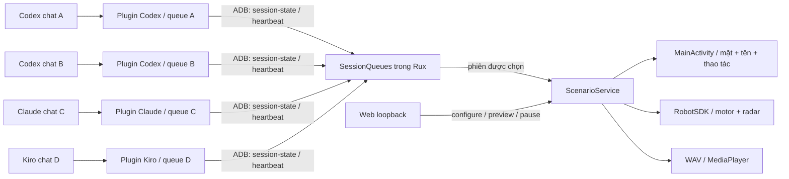

# Kiến trúc

Mỗi provider có config riêng ở ~/.config/rux-assistant/<provider>.json. Mỗi chat có
thư mục state riêng chứa SQLite, worker lock, sequence counter và heartbeat.
Không có bộ ưu tiên chat hay hàng đợi chung giữa các plugin trên máy tính.

Envelope có source, session_id, turn_id, sequence, state, title và activity.
Rux từ chối sequence cũ, giữ trạng thái mới nhất từng chat; không phát lại lịch sử
cử động của chat chưa được chọn. Lựa chọn giữ nguyên kể cả completed, idle, Stop
hoặc mất lease. Đổi chat bằng select-session tường minh. Chỉ bootstrap lần đầu mới
tự chọn luồng hoạt động đầu tiên.

ScenarioClock tách lease chuyển động khỏi trạng thái hiển thị. Lease 45 giây hết
thì dừng lặp motor, không đổi mặt. Completed có timer riêng 60 giây về idle; không
có timeout tương tự cho working/attention/failed. Heartbeat không khởi động lại
một episode đã dừng. Inbox ở RAM, restart không tự tiếp tục chuyển động.

ScenarioService giữ RobotSDK trong foreground service; hàng đợi phần cứng tuần tự
và finally ngắt motor. MainActivity chỉ hiển thị và chuyển intent. Khi mở mặt từ
ADB, dùng am start không force-stop; heartbeat gửi thẳng service.

Activity summary cập nhật mặt với cùng context/episode: không khởi động motor lại,
không nói lại và không đổi timer completed. PostToolUse xóa nhãn đúng tool_use_id.
Thông điệp chỉ có loại thao tác và basename, không có prompt/tool input thô.

Kịch bản lưu tại bộ nhớ riêng app (files/scenarios.json), AtomicFile bảo vệ cập nhật.
File scripts/active_scenario.json là bản trên host. Cài cập nhật giữ dữ liệu nếu
chữ ký hợp lệ; gỡ app/factory reset xóa dữ liệu. SDK và khả năng dừng radar phụ thuộc
firmware, ACK không phải xác nhận chuyển động vật lý.
